<a href="https://uni-helper.js.org/vite-plugin-uni-components"></a>

# uni-helper/vite-plugin-uni-components

<p style="text-align: center">
<a href="https://github.com/uni-helper/vite-plugin-uni-components/stargazers"></a>
<a href="https://www.npmjs.com/package/@uni-helper/vite-plugin-uni-components"></a>
<a href="https://www.npmjs.com/package/@uni-helper/vite-plugin-uni-components"></a>
</p>
<p style="text-align: center">
<a href="https://github.com/nei1ee"></a>
  <a href="https://github.com/ModyQyW"></a>
</p>

适用于 uni-app (Vue3) 的 unplugin-vue-components。

不想看文档？直接问 AI 🤖 <a href="https://deepwiki.com/uni-helper/vite-plugin-uni-components"></a>

## 安装

```bash
pnpm i -D @uni-helper/vite-plugin-uni-components
```

## 使用

📖 **请阅读[完整文档](https://uni-helper.js.org/vite-plugin-uni-components)了解完整使用方法。**

```ts
// vite.config.ts
import Uni from '@dcloudio/vite-plugin-uni'
import Components from '@uni-helper/vite-plugin-uni-components'
import { defineConfig } from 'vite'

export default defineConfig({
  plugins: [
    Components(), // 需要在 Uni() 之前调用
    Uni(),
  ],
})
```

## 感谢

- [unplugin-vue-components](https://github.com/unplugin/unplugin-vue-components)
